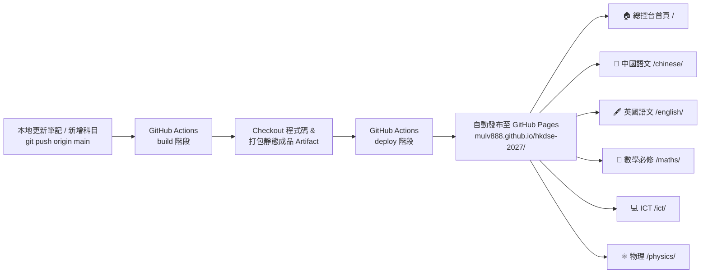

<div align="center">

# 🎓 2027 HKDSE 全科複習總控台 (HKDSE 2027 Revision Hub)

**專為 2027 屆香港中學文憑試（HKDSE）考生打造的一站式互動複習平台**  
涵蓋 **中國語文** · **英國語文 (English)** · **數學必修 (Mathematics)** · **資訊及通訊科技 (ICT)** · **物理 (Physics)**

[](https://github.com/mulv888/hkdse-2027/actions/workflows/deploy.yml)


<h3>🚀 <a href="https://mulv888.github.io/hkdse-2027/">點此立即開啟線上複習總控台（GitHub Pages）</a></h3>

</div>

---

## 📌 線上入口快速導覽

只需收藏一個總網址，即可在電腦、iPad 或手機隨時切換不同科目，所有溫習進度與重點收藏均會自動儲存在本地瀏覽器中：

| 入口 / 科目 | 線上直達網址 | 語言 / 閱讀模式 | 核心亮點 |
| :--- | :--- | :--- | :--- |
| 🏠 **2027 DSE 複習總控台** | [mulv888.github.io/hkdse-2027/](https://mulv888.github.io/hkdse-2027/) | 繁體中文 | 開考倒數計時器、五科溫習進度總覽、一鍵跳轉各科 |
| 📜 **中國語文科 (Chinese)** | [mulv888.github.io/hkdse-2027/chinese/](https://mulv888.github.io/hkdse-2027/chinese/) | 古白對照 / 背誦默書 | 十二篇範文精讀（16 篇）、文言字詞總集、2018–2026 真題、卷二寫作與名句默書 |
| 🖋️ **英國語文科 (English)** | [mulv888.github.io/hkdse-2027/english/](https://mulv888.github.io/hkdse-2027/english/) | 精讀 / 背誦遮蓋 / 朗讀 | Paper 2 十大文體格式、6 篇 5** 標註範文與套話升呢、Paper 3A 八大聆聽題型、Paper 4 口試話術連接詞與 1m/8m 計時器 |
| 📐 **數學必修 (Mathematics)** | [mulv888.github.io/hkdse-2027/maths/](https://mulv888.github.io/hkdse-2027/maths/) | 繁中 / 中英對照 / ENG | Paper 2 八大通法與 12 Topic 秒殺技巧、Paper 1 壓軸難題與 M/A 評分詳解、計數機 Program、限時刷題與錯題本 |
| 💻 **資訊及通訊科技 (ICT)** | [mulv888.github.io/hkdse-2027/ict/](https://mulv888.github.io/hkdse-2027/ict/) | 繁中 / 中英對照 / ENG | 必修 A–E、選修 A 數據庫（SQL）、選修 C Python、互動實驗室、速查表 |
| ⚛️ **物理科 (Physics)** | [mulv888.github.io/hkdse-2027/physics/](https://mulv888.github.io/hkdse-2027/physics/) | 繁中 / 中英對照 / ENG | Book 1–5、選修 E2 原子世界、選修 E3 能源使用、公式推導寶庫、高清 SVG 圖表 |

---

## ✨ 平台核心特性

- **⚡ 零外部依賴・極速載入**：全站以純原生 HTML / CSS / JavaScript 打造，不依賴任何外部 CDN 或後端伺服器，既可在 GitHub Pages 全球高速開啟，下載到本地雙擊 `index.html` 亦可 100% 離線使用。
- **📊 跨科溫習進度與收藏同步**：各科皆設有「✓ 標記已掌握」與「★ 加入重點收藏」功能，資料自動持久化至 `localStorage`，並於總控台首頁即時匯總各科進度。
- **🔎 全站即時搜尋（快捷鍵 `/`）**：無論搜尋文言字詞（如「陟罰臧否」、「景」）、SQL 語法（如 `3NF`、`JOIN`）或物理公式（如「光電效應」、「Lenz」），皆可一鍵直達考點。
- **🌓 護眼深淺色主題 ＋ 列印友善排版**：支援夜間深色模式減少視覺疲勞，並針對 A4 列印進行排版優化（自動隱藏側欄與導覽列），方便印出考前筆記。
- **📱 響應式設計（支援加至手機 / iPad 主畫面）**：在平板或手機瀏覽器點選「分享 ➔ 加入主畫面」，即可像專屬 App 般全螢幕溫習。

---

## 📚 各科詳細內容架構

### 1. 📜 中國語文科 (`chinese/`)
緊貼 **2024 年起精簡改制架構**（卷一閱讀能力 40% ＋ 卷二寫作能力 45% ＋ 校本評核 15%），針對 2027 年出題趨勢重點編寫：

- **考評總覽與 2027 趨勢預測**：收錄 2018–2026 歷屆十二篇範文考核熱度矩陣表、PEEL 滿分答題框架及五大跨篇章比較專題。
- **卷一甲部：十二篇指定文言經典精讀（共 16 篇獨立深度筆記）**：
  - 每篇包含作者背景、評卷參考級主旨、結構脈絡表、逐段／逐聯 **「古白對照」與「背誦默書模糊遮罩」**、修辭論證賞析、隨文字詞表與滿分問答示範。
  - <details>
    <summary>點擊展開全部 12 單元（16 篇）指定篇章清單</summary>

    1. 《論仁、論孝、論君子》（《論語》十六則全收錄）
    2. 《魚我所欲也》（孟子）
    3. 《逍遙遊》（節錄：大瓠之種、不龜手之藥、大樗之喻）（莊子）
    4. 《勸學》（節錄）（荀子）
    5. 《廉頗藺相如列傳》（節錄：完璧歸趙、澠池之會、負荊請罪）（司馬遷）
    6. 《出師表》（諸葛亮）
    7. 《師說》（韓愈）
    8. 《始得西山宴遊記》（柳宗元）
    9. 《岳陽樓記》（范仲淹）
    10. 《六國論》（蘇洵）
    11. 《唐詩三首》：王維《山居秋暝》、李白《月下獨酌（其一）》、杜甫《登樓》
    12. 《詞三首》：蘇軾《念奴嬌・赤壁懷古》、李清照《聲聲慢・秋情》、辛棄疾《青玉案・元夕》
    </details>
- **文言字詞與語法總合集（附「遮蓋釋義自測模式」）**：系統歸納一詞多義、通假字大全、古今異義奪命陷阱、詞類活用、八大核心虛詞及四大文言特殊句式。
- **歷屆真題甲部全解析（2018 樣本卷及 2018–2026）**：涵蓋九屆正式試卷與樣本卷之重點字詞釋義與問答題上品示範。
- **卷二寫作攻略**：
  - **甲部實用文**：書信、演講辭、建議書、評論文章、報告、倡議書、通告七大文體原稿紙視覺化格式範本，配搭 2024–2026 真題拆解。
  - **乙部記敘抒情文 & 議論文**：審題破題法、俗套選材避雷、五感細描與由情入理昇華、雙觀點辯證與駁論結構，以及將十二篇範文化用為議論文論據的「一魚兩吃」素材庫。
- **互動自測與名句默書室**：24 道高頻陷阱選擇題 ＋ 16 組易錯字名句默書填空挑戰。

---

### 2. 🖋️ 英國語文科 English Language (`english/`)
緊貼 **2024–2027 最新 HKDSE 考評大綱**（Paper 2 Part B 四選一制），針對寫作（Paper 2）、聆聽必答（Paper 3A）及口試（Paper 4）重點打造：

- **考評總覽與兩小時配速藍圖**：完整列出 Paper 1–4 比重（20% / 25% / 30% / 10% + SBA 15%）、Paper 2 C/L/O 21 分評分細則、120 分鐘黃金配速及三階段備戰路線圖。
- **Paper 2 十大文體格式合集**：涵蓋 Letter to the Editor、Formal Letter / Complaint / Application、Argumentative Essay、Feature Article、Proposal、Report、Speech、Blog / Informal Email、Short Story 及 Review；配備擬真答題紙排版批註、稱謂下款速查矩陣、考場地雷與一鍵複製開場句。
- **Paper 2 高分 5** 範文精讀室（6 篇全真示範）**：收錄 AI 教育致編輯信、Hustle Culture 議論文、綠色校園天台建議書、Gen Z 本土工藝專題文章、早會演講辭及 Part A 235 字校園網誌；內置**「🔍 5** 亮點標註」互動解析**（依詞彙、高階句型、銜接結構分色標示）、C/L/O 考官點評、可偷師金句表與語音朗讀。
- **Paper 2 套話與句式升呢庫**：六大段落功能高分例句庫（支援**「背誦遮蓋」填空自測**）、L3 ➔ L5** 六大黃金句型改造實驗室（否定倒裝、分詞構句、強調句、虛擬語氣等）及十大告別平庸字 C1/C2 替換表。
- **Paper 3A 聆聽八大題型示例與排雷大全**：覆蓋表格改口陷阱、原創 SVG 平面圖方位標註、流程圖倒敘、選擇題干擾排雷、對比勾選、語氣態度推斷、開放長答濃縮及 SVG 數據趨勢配對；附錄音原文折疊、Web Speech 模擬練耳朗讀及十大易錯串字表。
- **Paper 4 口試話術、自然連接詞與計時模擬室**：Part A 小組討論 7 大實戰場景話術（含互動延伸與冷場／麥霸救場神句）、自然口語 vs 生硬書面連接詞總表、Part B 一分鐘 IR 五大題型 10-22-18-10 藍圖與示範、港生 Chinglish 修正表，以及內建 **1 分鐘 IR / 8 分鐘 GI 倒數計時隨機抽題器**與 14 題跨卷互動自測題庫。

---

### 3. 📐 數學科必修部分 Mathematics (`maths/`)
嚴格按 **12 大考評 Topic**（代數多項式、二次函數變換、指數對數複數、變分誤差、線性規劃、AS/GS、平面與圓幾何、坐標圓與軌跡、三角形四心、2D/3D 三角學與求積、排列組合概率、統計離差）分類編排，配備離線數學公式排版與高清 SVG 幾何圖表：

- **考試總覽與計數機攻略**：Paper 1（65%）與 Paper 2（35%）黃金配速、Level 4–5** 分數線參考，以及 Casio fx-50FH II / fx-3650P II 四大神級 Program 與 `CMPLX` / `SD` / `CALC` 模式零失誤操作指南。
- **Paper 2 MC 秒殺技巧大全（按 12 大 Topic 分類）**：涵蓋「代質數消元、特例幾何、I/II/III 反例排除、極端值測試」等八大跨課題通法，以及各 Topic 的「🐢 傳統痛點 vs ⚡ 秒殺絕技」與干擾選項陷阱。
- **Paper 1 難題合集與精解（按 Topic 分類）**：精選 13 道 Section A(2) 與 Section B 壓軸難題（含銀行按揭等比數列、四心全貫通、3D 三垂線定理最大角、圓與切線軌跡、平截頭體注水等），提供**兩階段漸進展開（破題思路提示 ➔ 含 M/A 分的完整評分詳解）**。
- **Paper 2 限時實戰刷題室 ＋ 5** 核心公式總表 ＋ 錯題本**：內置 24 道覆蓋全部 12 Topic 的精選 MC（附計時秒錶、平均耗時統計與「秒殺法＋常規解」雙詳解），並整合考卷不印的核心必背公式與個人錯題收藏室。

---

### 4. 💻 資訊及通訊科技科 ICT (`ict/`)
支援 **繁體中文 / 中英對照 / English** 一鍵切換（快捷鍵 `L`），專攻 2027 DSE 新課程重點：

- **Paper 1 必修部分（Unit A – E）**：資訊處理（編碼、數據驗證與核對）、電腦系統基礎、互聯網及其應用、基本編程概念、資訊及通訊科技對社會的影響。
- **Paper 2 選修單元 A：數據庫 (Databases)**：關聯式模型、實體關係圖（ER Diagram）、數據正規化（1NF / 2NF / 3NF）、SQL 查詢語法（`SELECT`、`JOIN`、`GROUP BY`、`HAVING`、子查詢）與數據完整性。
- **Paper 2 選修單元 C：算法與編程 (Algorithm & Programming — Python)**：流程圖與偽代碼、排序與搜尋算法（線性／二分搜尋、冒泡／插入／歸併排序）、堆疊與佇列、時間複雜度與 Python 實戰追蹤。
- **互動實驗室與速查表**：內置互動實驗工具、模擬選擇題庫與考前高頻考點 Cheatsheets。

---

### 5. ⚛️ 物理科 Physics (`physics/`)
同樣支援 **繁體中文 / 中英對照 / English** 雙語切換，配備原創離線數學公式排版與高清可縮放 SVG 物理圖表：

- **Paper 1 必修部分（Book 1 – 5）**：
  - Book 1 熱和氣體（Heat & Gases）
  - Book 2 力和運動（Force & Motion）
  - Book 3A & 3B 波動學（Wave Motion I & II）
  - Book 4 電和磁（Electricity & Magnetism）
  - Book 5 放射現象和核能（Radioactivity & Nuclear Energy）
- **Paper 2 選修部分**：
  - **Elective 2 原子世界 (Atomic World)**：盧瑟福散射、光電效應、波爾原子模型、德布羅意波長、納米科技。
  - **Elective 3 能量和能源的使用 (Energy & Use of Energy)**：建築能源效率（U-value、OTTV）、照明與冷氣（COP）、電動車與再生能源。
- **公式推導寶庫 ＋ 核心 SVG 圖表庫 ＋ 模擬測驗**：將所有必背與須推導公式系統分組，並提供可點擊放大檢視的清晰光學、力學、電路與波形圖解。

---

## 🏗️ 系統與自動部署架構

本專案採用單一倉庫（Monorepo）管理所有科目，透過 **GitHub Actions** 兩階段流水線（`build` ➔ `deploy`）全自動發布至 **GitHub Pages**：



---

## 📂 專案目錄結構

```text
hkdse-2027/
├── index.html                        # 2027 HKDSE 複習總控台首頁（倒數計時 + 五科進度儀表板）
├── README.md                         # 專案說明文件
├── .nojekyll                         # 告知 GitHub Pages 直接提供靜態資源
├── .gitignore                        # 排除系統暫存檔與壓縮檔
├── .github/
│   └── workflows/
│       └── deploy.yml                # GitHub Actions 兩階段自動部署流程
├── chinese/                          # 📜 中國語文科複習寶典
│   ├── index.html
│   ├── css/styles.css
│   ├── data/                         # 十二篇範文(4檔)、字詞合集、歷屆真題、卷二寫作(3檔)、題庫
│   └── js/                           # app.js、quiz.js
├── english/                          # 🖋️ 英國語文科奪星寶典
│   ├── index.html
│   ├── css/styles.css
│   ├── data/                         # 總覽、P2 格式/範文/套話、P3A 聆聽題型、P4 口試話術、跨卷題庫
│   └── js/                           # app.js、practice.js（SVG 圖表、語音朗讀、口試計時器、自測）
├── maths/                            # 📐 數學必修科奪星寶典
│   ├── index.html
│   ├── css/styles.css
│   ├── data/                         # 12 Topic P2 秒殺技巧、P1 壓軸難題(2檔)、24 題 MC 刷題、公式庫
│   └── js/                           # app.js、drill.js、math.js、diagrams.js
├── ict/                              # 💻 資訊及通訊科技 (ICT) 複習寶典
│   ├── index.html
│   ├── css/styles.css
│   ├── data/                         # Paper 1 (A–E)、Elective A/C、Quizzes
│   └── js/                           # app.js、labs.js、quiz.js
└── physics/                          # ⚛️ 物理科 (Physics) 複習寶典
    ├── index.html
    ├── css/styles.css
    ├── data/                         # Book 1–5、Elective E2/E3、Formulas、Diagrams、Quizzes
    └── js/                           # app.js、math.js、diagrams.js、quiz.js
```

---

## 🛠️ 本地使用與日後擴充新科目

### 1. 本地離線瀏覽
```bash
git clone https://github.com/mulv888/hkdse-2027.git
cd hkdse-2027
open index.html   # macOS 直接在瀏覽器開啟，完全支援 file:// 協議
```

### 2. 新增其他科目（如數學 / 英文 / 公民科）
1. 在專案根目錄建立新資料夾（例如 `maths/` 或 `english/`），放入對應的 `index.html`、`css/`、`data/`、`js/`。
2. 在根目錄 `index.html` 中新增一張科目卡片連結至 `./maths/index.html`。
3. 執行以下指令推送至 GitHub，約 15–20 秒後 GitHub Actions 即自動更新線上網站：
```bash
git add -A
git commit -m "feat: 新增數學科複習網頁"
git push origin main
```

---

## 💡 給 2027 屆考生的溫習小貼士

> 1. **語文科貴在「每日一點」**：每天用 15 分鐘開啟「背誦默書模式」溫習一篇範文，並在「文言字詞合集」開啟遮蓋模式抽測 20 個字詞，積少成多。
> 2. **理科與 ICT 貴在「理解＋實作」**：善用中英雙語切換核對專有名詞，並多做模擬題庫檢視常犯概念陷阱。
> 3. **定期檢視「★ 重點收藏」**：考前最後一個月集中攻克自己標記收藏的薄弱單元，效率事半功倍。

---

<div align="center">

**祝願 2027 屆 HKDSE 考生沉著應戰、摘星奪魁、前程似錦！🌟**

*註：本網站整理之筆記與歷屆考點解析僅供個人溫習參考，一切最新考評安排請以香港考試及評核局（HKEAA）官方公布為準。*

</div>
